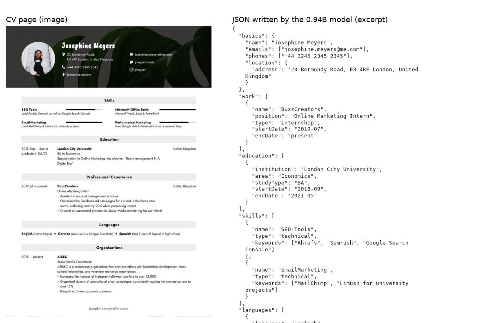
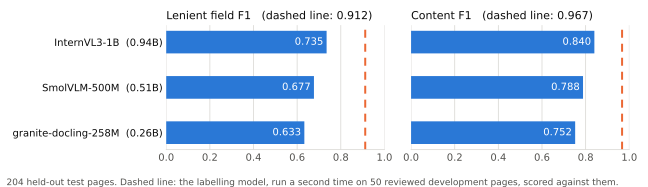
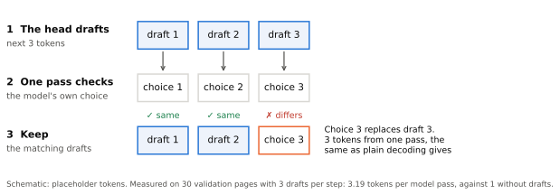
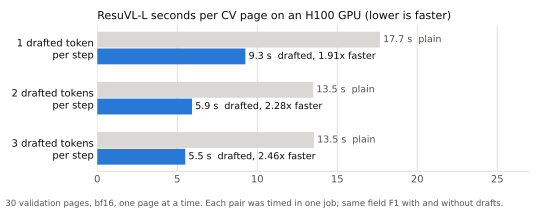
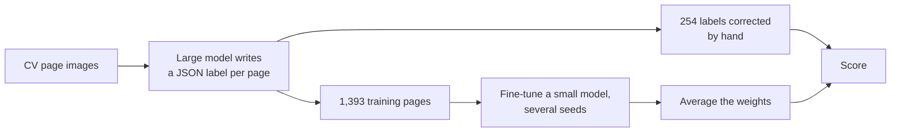
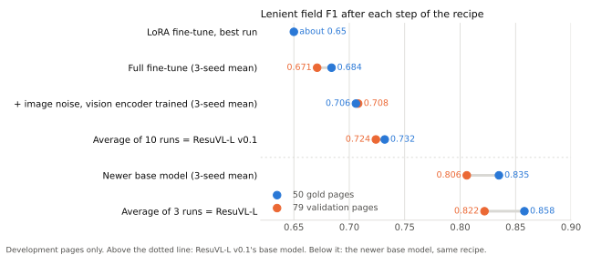

<h1 align="center">tiny-resume-parser</h1>

<p align="center">Small vision-language models (0.26B–0.87B parameters) that read a CV page image and write its content as JSON. They run on a laptop CPU.</p>

<p align="center">
  <a href="LICENSE.md"></a>
  
  <a href="https://github.com/iamkucuk/tiny-resume-parser/actions/workflows/tests.yml"></a>
  <a href="https://colab.research.google.com/github/iamkucuk/tiny-resume-parser/blob/main/examples/try_resuvl.ipynb"></a>
  <a href="https://colab.research.google.com/github/iamkucuk/tiny-resume-parser/blob/main/examples/train_on_eight_pages.ipynb"></a>
</p>

<p align="center"></p>
<p align="center"><sub>A validation page the model never trained on, and part of the JSON ResuVL-L (0.87B) wrote for it.</sub></p>

**In short:** on 204 held-out CV pages, ResuVL-L reaches a field F1 of 0.845.
86 % of the values it writes match the human-reviewed labels, and it finds 83 % of the values in those labels.
Run a second time on 50 reviewed pages, the model that made the training labels scores 0.912, which is the practical ceiling for models trained on its labels.

ResuVL-L reads one page in about a minute on a laptop CPU, with no GPU and no PDF text layer.
On an H100 GPU, it reads a page in about 5.5 seconds with drafted decoding (`--drafts 3`), against 13.5 seconds without it, at the same field F1.

Most resume parsers read the text layer of a PDF.
That layer can differ from what a recruiter sees in four ways:
- **Hidden text** is extracted like visible text.
- **Two-column layouts** come out interleaved.
- **Scanned pages** have no text layer at all.
- **Some PDFs** store text without a usable character mapping.

These models read the rendered page instead.
Every CV is handled the same way, whether it is a born-digital PDF, a scan or a photo.

> Weights on Hugging Face: [ResuVL-S](https://huggingface.co/furkankucuk/ResuVL-S) (0.26B), [ResuVL-M](https://huggingface.co/furkankucuk/ResuVL-M) (0.51B) and
> [ResuVL-L](https://huggingface.co/furkankucuk/ResuVL-L) (0.87B).

## Results



| Model | Parameters | Field F1 | Content F1 | CPU seconds per page |
|---|---|---|---|---|
| ResuVL-L | 0.87B | **0.845** | **0.916** | 55 |
| ResuVL-L v0.1 | 0.94B | 0.735 | 0.840 | 62 |
| ResuVL-M | 0.51B | 0.681 | 0.791 | 68 |
| ResuVL-S | 0.26B | 0.652 | 0.777 | 30 |

Scores are measured on 204 human-reviewed test pages that were not used for any decision.
When the labelling model labels 50 reviewed pages a second time, it scores 0.912 field F1 against them.
Its labels vary between runs, which limits what models trained on them can reach.

Field F1 counts a value as correct when it matches the reviewed label apart from case, spacing and punctuation.
Content F1 also accepts correct text placed under another field of the same section.
Definitions and development scores are in [docs/evaluation.md](docs/evaluation.md).

CPU times are medians over 10 validation pages on an Apple M2 Max.
These run in float32 except for ResuVL-L, whose language model runs in bf16 on CPUs that support it.
ResuVL-L v0.1 stays available as revision `v0.1.0` of the ResuVL-L repository.

**Faster on a GPU.** On an H100 GPU, drafted decoding (`--drafts 3`) cuts time per page from 13.5 to 5.5 seconds, 2.46 times faster, at the same field F1.
It gives no speed-up on a CPU.
Since version 0.3.0, ResuVL-L's weight file includes the multi-token prediction head of its base model, retrained for 16 minutes.

With `--drafts 3`, decoding proceeds in three steps:
1. The head proposes the next three tokens.
2. The model checks them in the same pass that writes its own next token.
3. Every draft that differs from the model's choice is replaced.



Details are in [findings](docs/findings.md#faster-decoding-with-the-base-models-drafting-head).



## Limits of the data

**The labels come from a model that was not made for French.**
GLM-5.3-Flash wrote every label, but its model card lists English and Chinese as its languages, while 80 % of the CVs are French.
Its errors on French text enter the training labels, and student models learn them.

The 254 test and development pages were reviewed by hand starting from those labels, and the review changed fewer than 1 % of values.
The test therefore measures agreement with reviewed model labels, not with labels written independently by people.
Run a second time, the labelling model scores 0.912 against the reviewed labels, which limits what models trained on its labels can reach.

**English-trained base models, a small and narrow sample of French.**
The base models that ResuVL was fine-tuned from learned to read mostly on English text.
ResuVL-S and ResuVL-M list English as their only language.
ResuVL-L and ResuVL-L v0.1 are listed as multilingual, but neither model card gives a share per language, and French is likely a small part next to English.

The training set gives about 330,000 words of French from 1,116 CV pages.
This French is narrow:
- **Names**, job titles and school names
- **Dates** and short skill lists
- **One-word values**: half of all values are one word long, and full sentences are few

Fine-tuning asks models that read English well to learn French from a small and narrow sample.
This sample covers little of French spelling, accents and vocabulary, while long training may weaken their initial English reading.
This makes training harder; how much of the remaining error it causes has not been measured.

The numbers behind these two points are in [docs/evaluation.md](docs/evaluation.md#labels-and-languages).

## Quickstart

```bash
pip install git+https://github.com/iamkucuk/tiny-resume-parser
tiny-resume-parser parse cv.pdf --model furkankucuk/ResuVL-L
```

```json
[{"file": "cv.pdf", "page": 1, "valid": true, "record": {"basics": {"name": "Josephine Meyers", "emails": ["josephine.meyers@me.com"]}, "work": [...]}}]
```

PDF pages are rendered at 120 dpi; PNG and JPEG files are read as they are.
`--model` also takes a model trained with [docs/training.md](docs/training.md).

On a GPU, `--drafts 3` makes ResuVL-L about 2.4 times faster.
A small extra layer in its weight file drafts next tokens, and the model checks them in one pass ([findings](docs/findings.md#faster-decoding-with-the-base-models-drafting-head)).

Two notebooks run on Colab or a local machine:
- **[examples/try_resuvl.ipynb](examples/try_resuvl.ipynb)** ([open in Colab](https://colab.research.google.com/github/iamkucuk/tiny-resume-parser/blob/main/examples/try_resuvl.ipynb)) reads an example page or your own CV with a released model and shows field by field what it got right, in about 5 minutes without a GPU.
- **[examples/train_on_eight_pages.ipynb](examples/train_on_eight_pages.ipynb)** ([open in Colab](https://colab.research.google.com/github/iamkucuk/tiny-resume-parser/blob/main/examples/train_on_eight_pages.ipynb)) trains a ResuVL-S model on the eight pages in [examples/](examples) to show every training step. A copy with all outputs is [examples/train_on_eight_pages_executed.ipynb](examples/train_on_eight_pages_executed.ipynb).

[docs/code-tour.md](docs/code-tour.md) walks through the code in the order a page travels.

## Training pipeline



A large model (GLM-5.3-Flash) labels each page once.
Each small model is fully fine-tuned to write the same JSON from the page image alone, several times with different seeds.
The fine-tuned weights are averaged into one model of the same size.

[docs/how-it-works.md](docs/how-it-works.md) describes each step.
To read a CV, the released model receives only the page image and writes the JSON in one pass.
No large model and no PDF text layer are used ([reading a CV](docs/how-it-works.md#reading-a-cv)).

## Findings



The largest gain came from the base model.
ResuVL-L and ResuVL-L v0.1 use the same training recipe and differ only in their base models.
ResuVL-L scores 0.845 on the test pages against 0.735 for ResuVL-L v0.1, although ResuVL-L is smaller (0.87B parameters against 0.94B).

Within one base model, three changes raised the score most:
- **Full fine-tuning** of all weights instead of LoRA adapters
- **Image noise** added while also training the vision encoder
- **Weight averaging** of several fine-tuned models

Several methods did not improve the score:
- **Preference training** (DPO)
- **Reinforcement learning** on the F1 score (GRPO), which stayed within the seed spread on training pages and on 974 unseen pages
- **Key-by-key generation** of one JSON key at a time
- **Constrained decoding**

On a GPU, the base model's own multi-token prediction head, retrained for 16 minutes, drafts tokens that ResuVL-L checks in one pass.
This makes decoding 2.3 to 2.5 times faster at the same F1.
[docs/findings.md](docs/findings.md) gives the measured effect of each change.

The largest group of remaining errors is values the model leaves out.
Misread characters are one of the smallest groups.

## Repository

```
src/tiny_resume_parser/   the package: schema, data, models, train, generate, draft, evaluate, metrics, soup, label, parse
configs/                  training settings for each model
examples/                 eight labelled pages and a notebook that trains on them (Colab or local)
slurm/                    cluster jobs: train and score, average, test
tests/                    scoring rules, PDF input, configs
docs/                     method, code tour, evaluation, training, findings, model card; research/ = the lab log
```

## Limitations

- Each page is returned separately; pages of one CV are not merged.
- The training CVs come from one dataset.
- Instructions written in visible text on the page are read like any other text; this has not been tested.

## Citation

```bibtex
@software{kucuk2026tinyresumeparser,
  author = {Kucuk, Furkan},
  title  = {tiny-resume-parser: small vision-language models that read CV page images into JSON},
  year   = {2026},
  url    = {https://github.com/iamkucuk/tiny-resume-parser}
}
```

The page images come from the [Cv Parsing Dataset](https://universe.roboflow.com/invoicemodelisation/cv-parsing-ksgbu) (invoiceModelisation, Roboflow Universe, 2024, [CC BY 4.0](https://creativecommons.org/licenses/by/4.0/)).
They were deduplicated and grouped into CVs.
The dataset's bounding boxes were not used.

## Licence

Code: [PolyForm Noncommercial 1.0.0](LICENSE.md), free for personal, research, educational and nonprofit use, not for commercial use.
Weights and documentation: CC BY-NC 4.0.

ResuVL-S, ResuVL-M, ResuVL-L and ResuVL-L v0.1 are fine-tuned from [granite-docling-258M](https://huggingface.co/ibm-granite/granite-docling-258M), [SmolVLM-500M-Instruct](https://huggingface.co/HuggingFaceTB/SmolVLM-500M-Instruct), [Qwen3.5-0.8B](https://huggingface.co/Qwen/Qwen3.5-0.8B) and [InternVL3-1B-hf](https://huggingface.co/OpenGVLab/InternVL3-1B-hf).
Each base model keeps its own licence.

