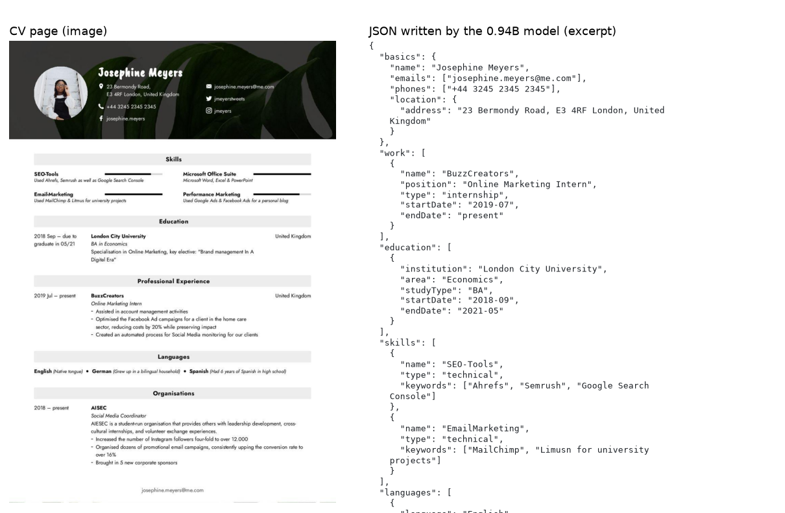
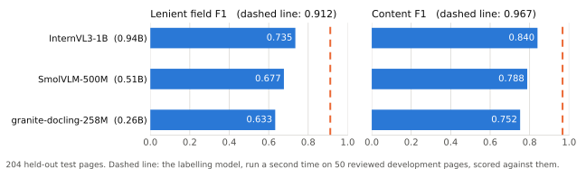
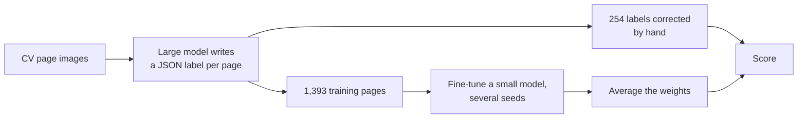

<h1 align="center">tiny-resume-parser</h1>

<p align="center">Small vision-language models (0.26B–0.94B parameters) that read a CV page image and write its content as JSON. They run on a laptop CPU.</p>

<p align="center">
  <a href="LICENSE.md"></a>
  
  <a href="https://github.com/iamkucuk/tiny-resume-parser/actions/workflows/tests.yml"></a>
</p>

<p align="center"></p>
<p align="center"><sub>A validation page the model never trained on, and part of the JSON the 0.94B model wrote for it.</sub></p>

Most resume parsers read the text layer of a PDF. That layer can differ from what a recruiter sees: hidden text is
extracted like visible text, two-column layouts come out interleaved, scanned pages have no text layer at all, and
some PDFs store text without a usable character mapping. These models read the rendered page instead, so every CV
is handled the same way, whether it is a born-digital PDF, a scan or a photo.

> Research in progress. Model weights are not published yet.

## Results



| Model | Parameters | Field F1 | Content F1 | CPU seconds per page |
|---|---|---|---|---|
| InternVL3-1B | 0.94B | **0.745** | **0.844** | 62 |
| SmolVLM-500M | 0.51B | 0.677 | 0.788 | 68 |
| granite-docling-258M | 0.26B | 0.633 | 0.752 | 30 |

Scores are on 204 human-reviewed test pages that were not used for any decision. Field F1 counts a value as correct
when it matches the reviewed label apart from case, spacing and punctuation. Content F1 also accepts correct text
placed under another field of the same section. When the labelling model labels 50 reviewed pages a second time,
it scores 0.912 field F1 against them: its labels vary between runs, which limits what models trained on them can
reach. Definitions and development scores are in
[docs/evaluation.md](docs/evaluation.md); CPU times are medians over 10 validation pages on an Apple M2 Max in float32.

## Quickstart

```bash
pip install git+https://github.com/iamkucuk/tiny-resume-parser
tiny-resume-parser parse cv.pdf --model PATH_TO_MODEL
```

```json
[{"file": "cv.pdf", "page": 1, "valid": true, "record": {"basics": {"name": "Josephine Meyers", "emails": ["josephine.meyers@me.com"]}, "work": [...]}}]
```

PDF pages are rendered at 120 dpi; PNG and JPEG files are read as they are. Until weights are published, `--model`
takes a model trained with [docs/training.md](docs/training.md).

## How it works



A large model (GLM-5.3-Flash) labels each page once. Each small model is then fully fine-tuned to write the same
JSON from the page image alone, several times with different seeds, and the fine-tuned weights are averaged into
one model of the same size. [docs/how-it-works.md](docs/how-it-works.md) describes each step.

## Findings

For the 0.94B model, three changes raised the score most: fine-tuning all weights instead of LoRA adapters, adding image noise while
also training the vision encoder, and averaging the weights of several fine-tuned models. Preference training
(DPO), reinforcement learning on the F1 score (GRPO), generating one JSON key at a time and constrained decoding
did not improve it; for GRPO, the training pages left little room above the answer the model already gave. The largest group of remaining errors is values the model leaves out; misread characters are one of the smallest.
[docs/findings.md](docs/findings.md) gives the measured effect of each change.

## Repository

```
src/tiny_resume_parser/   the package: schema, data, models, train, generate, evaluate, metrics, soup, label, parse
configs/                  training settings for each model
slurm/                    cluster jobs: train and score, average, test
tests/                    scoring rules, PDF input, configs
docs/                     method, evaluation, training, findings, model card; research/ = the lab log
```

## Limitations

- Each page is returned separately; pages of one CV are not merged.
- The training CVs are mostly French and English and come from one dataset.
- Instructions written in visible text on the page are read like any other text; this has not been tested.
- All labels come from one labelling model.

## Citation

```bibtex
@software{kucuk2026tinyresumeparser,
  author = {Kucuk, Furkan},
  title  = {tiny-resume-parser: small vision-language models that read CV page images into JSON},
  year   = {2026},
  url    = {https://github.com/iamkucuk/tiny-resume-parser}
}
```

The page images come from the [Cv Parsing Dataset](https://universe.roboflow.com/invoicemodelisation/cv-parsing-ksgbu)
(invoiceModelisation, Roboflow Universe, 2024, [CC BY 4.0](https://creativecommons.org/licenses/by/4.0/)). They
were deduplicated and grouped into CVs; the dataset's bounding boxes were not used.

## Licence

Code: [PolyForm Noncommercial 1.0.0](LICENSE.md), free for personal, research, educational and nonprofit use, not for
commercial use. Weights and documentation, once released: CC BY-NC 4.0. Each base model
([InternVL3-1B-hf](https://huggingface.co/OpenGVLab/InternVL3-1B-hf),
[SmolVLM-500M-Instruct](https://huggingface.co/HuggingFaceTB/SmolVLM-500M-Instruct),
[granite-docling-258M](https://huggingface.co/ibm-granite/granite-docling-258M)) keeps its own licence.
