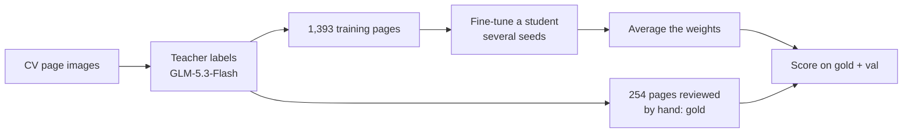

<h1 align="center">tiny-resume-parser</h1>

<p align="center"><b>Small vision-language models (0.26B–0.94B) that read a CV page image the way a recruiter does and write ATS-ready JSON — on a laptop CPU.</b></p>

<p align="center">
  <a href="LICENSE.md"></a>
  
  <a href="https://github.com/iamkucuk/tiny-resume-parser/actions/workflows/tests.yml"></a>
  
</p>

<p align="center"></p>
<p align="center"><sub>A validation page the model never trained on, and an excerpt of the JSON the 0.94B student wrote for it (strict field F1 0.82 against the teacher label).</sub></p>

> **Status: research in progress.** Scores are on the development pages; the 204-page held-out test set is being
> scored now. Model weights are not published yet.

## Why read the page image instead of the PDF text

Most resume parsers read the PDF's text layer. That layer is not what a recruiter sees:

| Problem with the PDF text layer | Reading the rendered page |
|---|---|
| **Hidden text** — white, tiny or off-page text (keyword stuffing, instructions aimed at an AI screener) is extracted like any other text | text that is not visible is not in the image |
| **Reading order** — two columns, sidebars and tables come out interleaved | the model sees the layout |
| **Scans and photos** — no text layer at all; OCR adds its own errors | same input as a born-digital PDF: one image |
| **Broken PDFs** — fonts without Unicode mapping, text drawn as curves | whatever renders correctly can be read |

One model handles every CV the same way, whatever produced it. Not solved: an instruction written in **visible**
text is read by the model as it is by a person; robustness to that has not been tested yet.

## Results


| Student | Params | Lenient F1 gold / val | Content F1 gold / val | CPU s/page |
|---|---|---|---|---|
| InternVL3-1B (average of 10 fine-tunes) | 0.94B | **0.728 / 0.732** | **0.839 / 0.852** | 62 |
| granite-docling-258M (average of 4) | 0.26B | 0.660 / 0.649 | 0.798 / 0.780 | 30 |
| SmolVLM-500M (average of 3) | 0.51B | 0.644 / 0.676 | 0.813 / 0.797 | 59 |
| *Teacher: GLM-5.3-Flash vs human-reviewed labels* | *~300B* | *0.912* | *0.967* | |

*Lenient* field F1 ignores case, spacing and punctuation; any letter or digit difference is an error. *Content* F1
also accepts correct words placed under another field of the same section. Gold = 50 human-reviewed pages,
val = 79 teacher-labelled pages; CPU = Apple M2 Max, float32. The teacher's own 0.912 is the ceiling for students
trained on its labels. Definitions, examples and commands: [docs/evaluation.md](docs/evaluation.md).

## Quickstart

```bash
pip install git+https://github.com/iamkucuk/tiny-resume-parser
tiny-resume-parser parse cv.pdf --model PATH_TO_MODEL
```

```json
[{"file": "cv.pdf", "page": 1, "valid": true, "record": {"basics": {"name": "Josephine Meyers", "emails": ["josephine.meyers@me.com"], ...}, "work": [...]}}]
```

PDF pages are rendered at 120 dpi; images (PNG, JPEG) are read as they are. Until the weights are published,
`--model` takes a model you trained ([docs/training.md](docs/training.md)).

## How it works



A large teacher labels each page once; small students learn to write the same JSON from the image alone; several
fine-tuned copies of each student are averaged into one model of the same size. Details:
[docs/how-it-works.md](docs/how-it-works.md).

## Research highlights

Every change was tested against a named baseline over several seeds, and kept only if it beat the seed-to-seed
spread on both development sets. The full record, including everything that did not work, is in
[docs/research/](docs/research/README.md).

| Kept | Lenient F1 gain (gold / val) |
|---|---|
| Averaging the weights of 10 fine-tuned seeds | +0.024 / +0.024 over the seed mean |
| Image noise during training | +0.035 / +0.007 (3 seeds) |
| Training the vision encoder too | +0.011 / +0.022 (3 seeds) |
| SmolVLM: 30 image tiles instead of 12 | +0.043 / +0.032 (2 seeds) |

| Tried and rejected | Result |
|---|---|
| Preference training (DPO), reinforcement learning (GRPO) on field F1 | lower / no change |
| Key-by-key generation (one call per JSON key) | equal on gold, −0.022 on val, 29× the calls |
| Schema-constrained decoding, repetition penalty | no gain |
| NEFTune embedding noise; lower vision-encoder learning rate | no gain / lower |

Where errors remain: values the model **leaves out** are the largest loss (10.6 % of gold values); misread
characters are among the smallest (2.9 %).

## Repository layout

```
src/tiny_resume_parser/   the package — schema, data, models, train, generate, evaluate, metrics, soup, label, parse
configs/                  one training recipe per student (TOML)
scripts/                  data preparation and figure scripts
experiments/              code for methods that were tried and not adopted
truba/                    SLURM jobs used on the TRUBA cluster
tests/                    scoring rules, PDF input, configs, key-by-key round trip
notebooks/                Colab notebooks (first LoRA run, CPU/GPU speed test)
docs/                     how it works, evaluation, training, model card, research record
```

## Limitations

- One page at a time: pages of a multi-page CV are returned separately, not merged.
- Trained on mostly French and English CVs from one dataset; other languages and layouts are untested.
- Robustness to injected instructions on the page has not been measured.
- Labels come from one teacher model (0.912 agreement with human review).

## Citation

```bibtex
@software{kucuk2026tinyresumeparser,
  author = {Kucuk, Furkan},
  title  = {tiny-resume-parser: small vision-language models that read CV page images into ATS JSON},
  year   = {2026},
  url    = {https://github.com/iamkucuk/tiny-resume-parser}
}
```

## Licence and data

- Code: [PolyForm Noncommercial 1.0.0](LICENSE.md) — free for personal, research, educational and nonprofit use;
  commercial use is not permitted. This is a source-available licence, not an OSI open-source licence.
- Model weights and documentation (when released): CC BY-NC 4.0.
- CV page images: Roboflow Universe CV dataset, CC BY 4.0. **Source link and author credit: to be added before release.**
- Base models: [InternVL3-1B-hf](https://huggingface.co/OpenGVLab/InternVL3-1B-hf),
  [SmolVLM-500M-Instruct](https://huggingface.co/HuggingFaceTB/SmolVLM-500M-Instruct),
  [granite-docling-258M](https://huggingface.co/ibm-granite/granite-docling-258M), each under its own licence.
