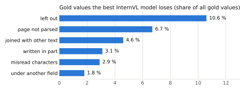

# Evaluation

Every number in this repository comes from [`metrics.py`](../src/tiny_resume_parser/metrics.py), and each metric
below has a test in [`tests/test_scoring.py`](../tests/test_scoring.py).

## Field F1

A record is flattened into (path, value) pairs, list positions ignored (Donut-style field F1, arXiv 2111.15664):

```
{"work": [{"name": "BuzzCreators", "startDate": "2019-07"}]}  ->  ("work.name", "BuzzCreators"), ("work.startDate", "2019-07")
```

Precision = matched pairs / predicted pairs; recall = matched pairs / gold pairs; pooled over all pages. A page whose
answer is not JSON counts as zero predicted pairs.

| Metric | A pair matches when … | Same | Different |
|---|---|---|---|
| **strict** | path and value are identical | `Sfax, Tunisie` = `Sfax, Tunisie` | `NVIDIA` ≠ `Nvidia` |
| **lenient** (headline) | path matches; values match after casefolding and dropping everything that is not a letter or digit | `NVIDIA` = `Nvidia`; `+33 6 12-34` = `+33612 34` | `2021-04` ≠ `2021-04-21`; `Picard` ≠ `Picart`; `é` ≠ `e` |
| **content** | the same words appear in the same top-level section, wherever they were placed | `skills.name: "Python, SQL"` = `skills.name: "Python"` + `skills.keywords: ["SQL"]` | `Python` under `interests` ≠ under `skills` |

Lenient F1 is the headline number: case, spacing and punctuation are not errors for an applicant-tracking import,
but any letter or digit difference is. Content F1 measures reading separately from field placement: the teacher
itself splits and places text inconsistently, so a student is penalised for choices the teacher makes at random.

**Repair** (reported next to raw, never instead): a broken answer keeps its complete values up to the break and
duplicate list items are dropped. This is what `tiny-resume-parser parse` returns.

## Protocol

- **Development sets** for every decision: 50 reviewed gold pages + 79 validation pages (5% of training CVs, chosen
  by a hash of the CV id, teacher labels).
- **Test set**: 204 reviewed gold pages, scored once per milestone so the reported number is not chosen on the pages
  it reports.
- **Epoch choice**: on the validation pages; gold is reported at that epoch.
- **A change is adopted** only if it beats the seed-to-seed spread (~0.01–0.02 F1, up to 0.058 for the smaller
  students) on both development sets. Single-seed results of the smaller students are checked with paired seeds.

## Results

| Student | Lenient F1 gold / val | Content F1 gold / val | Test (204 pages) |
|---|---|---|---|
| InternVL3-1B (average of 10) | 0.728 / 0.732 | 0.839 / 0.852 | running |
| SmolVLM-500M (average of 3) | 0.644 / 0.676 | 0.813 / 0.797 | running |
| granite-docling-258M (average of 4) | 0.660 / 0.649 | 0.798 / 0.780 | running |
| *Teacher vs reviewed gold* | *0.912* | *0.967* | |

Reproduce a row:

```bash
tiny-resume-parser evaluate --model runs/NAME/model --set gold --limit 50 --max-patches 12 --out runs/NAME/eval_gold
tiny-resume-parser rescore runs/NAME/eval_gold
```

Test pages: `--set gold --start 50`. SmolVLM: `--max-patches 30 --max-new-tokens 3000`.

## Where the remaining errors are

<picture>
  <source media="(prefers-color-scheme: dark)" srcset="assets/lost-values-dark.svg">
  
</picture>

Values the model leaves out are the largest loss; misread characters are among the smallest. Three of the 50 gold
pages produce no parseable answer and carry 6.7 % of all gold values.
