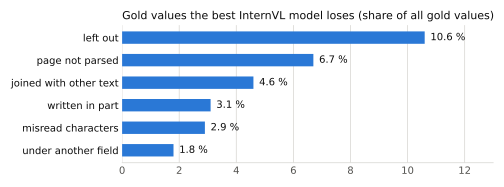

# Findings

This page summarises what changed the score and what did not, in the order the work happened. A change was kept only if it beat the seed-to-seed spread of about 0.012 F1 on both development sets. Every change was compared with a named baseline run, usually over three training seeds.

Scores below are lenient field F1 on 50 reviewed gold pages and 79 validation pages, written as gold / validation. The full record of every run, including the reasoning before each one, is in the [research log](research/journal.md). The code of the methods that were not adopted is kept in the [`archive-2026-10-15`](https://github.com/iamkucuk/tiny-resume-parser/tree/archive-2026-10-15) tag.

## How the recipe developed

The recipe developed through successive changes evaluated against baselines on both development sets. However, several changes helped only one set or failed to transfer across model sizes.

**Getting a valid answer at all.** The first LoRA fine-tune for ResuVL-L v0.1 reached a low training loss, yet none of 10 answers was valid JSON. Every answer repeated one entry of the label's `corrections` list until the 2,500-token limit. That list recorded spelling fixes made by the labelling model, so its content was not visible on the page.

Removing `corrections` from the target, together with token perturbation, raised valid answers to 21 of 50. Token perturbation replaced one input token with a random token on about one page in ten while keeping the target correct (Nougat, arXiv 2308.13418). A later test with the final recipe turned perturbation off over 3 seeds, scoring 0.716 / 0.711 compared with 0.706 / 0.708 with it.

Turning perturbation off did not reduce loops, as 8 answers hit the token limit either way. The loops ended because the `corrections` list was removed. Training loss did not show the loops; only generating answers did.

The two smaller models confirmed this result:
- **ResuVL-S without perturbation** scored 0.610 / 0.618 against 0.617 / 0.611 with it across 3-seed means.
- **ResuVL-S with Nougat strength** (about 9 replaced tokens per page) dropped to 0.583 / 0.608.
- **ResuVL-M with stronger perturbation** scored 0.628 / 0.665 compared with 0.619 / 0.654, which stayed within the seed spread.
- **The average of the three ResuVL-M models with the stronger setting** scored 0.674 / 0.658 against 0.644 / 0.676 for the average with the light setting: higher on one set, lower on the other.

The recipe keeps the light setting.

**LoRA, then full fine-tuning.** More epochs, a trainable image-to-text projector, and 12 image tiles instead of 6 brought LoRA to about 0.65 on gold pages, where improvement stopped. The 12 tiles helped tall pages (+0.094 on the 6 tall gold pages) and nothing else. Fine-tuning all weights instead gave 0.693 / 0.669, gaining about +0.03 over LoRA.

**Image noise and the vision encoder.** Adding mild image noise and training the vision encoder raised the 3-seed mean from 0.684 / 0.671 to 0.706 / 0.708. Mild noise included lower resolution, rotation up to 1.5°, contrast, blur, and JPEG artefacts on half of the pages. Each change alone helped only one of the two sets.

**Weight averaging.** Averaging the weights of 10 fine-tuned models ("model soup", arXiv 2203.05482) gave 0.732 / 0.724. This was a gain of +0.023 / +0.017 over the single-model mean of 0.709 / 0.707, at no extra inference cost. Larger averages of 13 to 19 models did not score higher on validation in earlier runs.

ResuVL-L v0.1 averages 10 runs trained only on the licensed pages.

**Answer repair.** On 1 of the 50 gold pages, ResuVL-L v0.1 writes invalid JSON caused by a loop, a bad escape, or a missing comma. Repairing answers after generation raises gold from 0.732 to 0.739 and leaves validation unchanged. Post-processing fixes escapes, keeps complete values before the break, and drops repeated list items.

Development decisions compare unrepaired answers; the `parse` command returns repaired ones.

**More data.** Training on half of the pages reduced scores by 0.04 to 0.08 for the same step count, showing that distinct page count matters. Adding 993 pages from a second dataset gave +0.011 / +0.013 over 6 seeds, which falls within noise. Because its licence is unknown, released weights do not use this second dataset.

**The two smaller models.** The ResuVL-L v0.1 recipe did not transfer directly to smaller models. ResuVL-M's base model scored only 0.370 / 0.460 with it, and 10 of its 50 gold answers looped to the token limit. A 6× higher learning rate and 10 epochs improved ResuVL-M to 0.596 / 0.627.

Using 30 image tiles instead of 12 added +0.043 / +0.032 to ResuVL-M. Using 20 tiles scored the same over 3 seeds and ran only 4 % faster on CPU. Averaging 3 seeds gave 0.644 / 0.676 for ResuVL-M.

ResuVL-S required an even higher learning rate of 1e-4 (+0.024 / +0.031 over 6e-5) and scored worse with more than 12 tiles. Its 4-seed average reached 0.660 / 0.649, an increase of +0.044 / +0.033 over a single model.

## What did not help

Several training and decoding modifications failed to beat the baseline. Most of these attempts fell within the seed spread, lost score, or slowed decoding.

| Tried | Result |
|---|---|
| Preference training (DPO) on the model's own wrong answers | gold fell at every checkpoint, from 0.650 to 0.539 |
| Reinforcement learning (GRPO) with field F1 as the reward, 4 settings | 0.705–0.718 / 0.704–0.718, starting from 0.705 / 0.719 |
| Generating one JSON key per call (29 calls per page) | at best 0.728 / 0.710 against 0.728 / 0.732 |
| Decoding constrained to the schema | 0.694 against 0.693 and 5.4× slower; useful only to guarantee valid JSON |
| Stopping loops at generation time (repetition penalty, banning repeated word sequences) | no gain on ResuVL-L v0.1, lower on ResuVL-M; the ban also broke normal JSON |
| Multi-token prediction as an extra training loss (ResuVL-L, weight 0.3, 5 seeds; arXiv 2404.19737) | 0.827 / 0.814 against 0.836 / 0.808 without it |

Smaller changes with measured scores also failed:

| Smaller change | Result |
|---|---|
| Training on labels rewritten into a canonical form | −0.01 |
| 24 image tiles for ResuVL-L v0.1 | −0.05 on gold |
| 2 pages per step | −0.02 |
| Second model that checks and fixes labels | Fixed 14 real errors on 30 pages and introduced about 8 new ones |

Other changes that did not help include other learning rates and epoch counts, NEFTune noise on text embeddings, and a 10× lower learning rate for the vision encoder. A first training stage on page transcripts also failed to help. Their numbers are in the [research log](research/journal.md).

## Why reinforcement learning did not help

Reinforcement learning with GRPO did not improve over supervised fine-tuning. Across four tested hyperparameter settings, all runs ended within the seed spread.

GRPO started from a fully fine-tuned ResuVL-L v0.1 model scoring 0.705 / 0.719. For each training page, it sampled 4 answers at temperature 1 and rewarded each with its field F1 against the label. Training ran for about 350 steps of 4 pages. Four settings were tested: learning rate 1e-6, learning rate 3e-6, temperature 0.7, and a KL penalty.

The training logs, the answers before and after, and 8 new samples per page from the starting model show why ([`grpo_probe.py`](https://github.com/iamkucuk/tiny-resume-parser/tree/archive-2026-10-15/experiments/grpo_probe.py)).

**The answers changed, but not in one direction.** After GRPO, 39 to 46 of the 50 gold answers differed from before, matching the variation seen after one more supervised epoch. On pages that stayed valid JSON, values gained and lost cancelled out (+79 and −75 at learning rate 1e-6). The net change came from a few pages switching between valid and invalid JSON, each holding about 100 values, causing gold and validation to move in opposite directions.

**There was a learning signal, but little room on the training pages.** The 4 samples of a page differed by about 0.23 F1, and only 1 % of groups gave no signal. However, room above the greedy answer was small on training pages because supervised training had already fitted them:

| Starting model, 8 samples per page | Greedy answer | Mean sample | Best sample | Pages where a sample beats greedy by > 0.02 |
|---|---|---|---|---|
| 40 training pages | 0.910 | 0.811 | 0.925 | 8 of 40 |
| 50 gold pages (not trained on) | 0.703 | 0.571 | 0.768 | 27 of 50 |

**Much of the reward measured whether a sample was valid JSON.** At temperature 1, 4 % of samples on training pages were not JSON, compared with 14 % on gold pages. Leaving out invalid samples cut reward variance within a page to a third. Greedy decoding rarely produces invalid JSON, so learning to avoid it raised training reward without altering greedy outputs.

**The reward also follows the labels' arbitrary splits.** For 24 % of sample pairs, field F1 and content F1 ranked the two samples in opposite order. Field F1 preferred samples splitting text to match the label, even when the alternative had more correct content.

One expected cause turned out to be wrong: the model does produce many missed values. Of values missed by the greedy answer, 74 % on training pages and 56 % on gold pages appeared in at least one of the 8 samples. The reward simply did not concentrate on them.

Two follow-ups were then tested. GRPO on 974 pages the supervised model had never seen (on unseen gold pages a sample beat the greedy answer on 27 of 50, against 8 of 40 training pages) was run with each reward. Compared with the starting model's 0.705 / 0.719, field F1 reward scored 0.708 / 0.714 and content F1 reward scored 0.718 / 0.712. Both remained within the seed spread; keeping only pages where a sample beats greedy remains untested.

## A newer base model: ResuVL-L

A newer base model within the 1B limit gave the largest single score gain. Further tuning of the recipe on this base model did not produce additional gains.

A literature search in October 2026 ranked this newer base model ahead of adding more data or transferring from a larger model. ResuVL-L was trained with the ResuVL-L v0.1 recipe unchanged, using this newer and smaller base model.

**The new base model is the largest single gain.** Three runs averaged 0.835 / 0.806 compared with 0.711 / 0.707 for ResuVL-L v0.1, about six times the seed spread on both sets. Every epoch from the fourth onward scored at least 0.826 on gold pages. Averaging the three runs gave 0.858 / 0.822, which forms the released ResuVL-L.

The base model uses a newer, larger language model, and its model card describes joint early training on image and text tokens. Which of these two factors drove the gain was not tested.

**The ResuVL-L recipe was not improved by further tuning.** Settings from ResuVL-L v0.1 were retained after three checks against the five-seed mean of 0.836 / 0.808:
- **Learning rate**: A 2× higher learning rate gave 0.840 / 0.799 compared with 0.836 / 0.808.
- **Epoch count**: Ten epochs gave 0.829 / 0.809 instead of 0.836 / 0.808 for six epochs, with validation staying between 0.80 and 0.82 from the fifth to the tenth epoch, so the model has converged by the sixth.
- **Image tiles**: 20 tiles gave 0.842 / 0.820 and 30 tiles gave 0.845 / 0.814 over five seeds, but increased CPU image token costs up to 1.7 times.

Because the validation gain was at the edge of the seed spread and gold gain remained inside it, 12 tiles were kept.

**Synthetic pages: the gain was mostly longer training.** Adding 1,000 synthetic pages with exact labels to ResuVL-L v0.1 gave 0.741 / 0.724 against 0.711 / 0.707. These pages featured new names, contact details, four layouts, nine fonts, and nine colours. However, these runs took 882 training steps instead of the standard 528 steps.

Training ResuVL-L v0.1 on real pages alone for the same 882 steps (10 epochs) reached 0.716 / 0.723. With training steps matched, synthetic pages added +0.025 on gold and nothing on validation, so they were not adopted.

Using 3,000 synthetic pages scored 0.750 / 0.742 after about 1,650 steps, but no real-page run matched that length. On ResuVL-L, 1,000 synthetic pages yielded 0.843 / 0.812 compared with 0.835 / 0.806.

## Faster decoding with the base model's drafting head

The base model's multi-token prediction head speeds up GPU decoding without reducing F1 accuracy. However, this drafted decoding provides no speedup on a CPU.

ResuVL-L's base model includes a multi-token prediction (MTP) head that predicts the token after next from the current state and next token. ResuVL-L fine-tuning did not use this head, and the initial release omitted it. The mechanism operates as speculative decoding with a built-in draft model, similar to DeepSeek-V3 and vLLM's Qwen3.5 support.

Because disagreeing tokens are replaced by the base model's choice, the output matches greedy decoding.

**The head needed only 16 minutes of training.** Attached unchanged to ResuVL-L, the pretrained head drafted 86 % of tokens correctly and accelerated H100 decoding 1.60 times on 129 development pages (0.857 / 0.828 versus 0.864 / 0.826). Training only the head's 20 million parameters on frozen model answers for two epochs took 16 minutes. This training raised correct drafts on model answers from 87.6 % to 97.6 % on 20 validation pages without changing release model weights.

**Two or three drafted tokens per step give 2.3 to 2.5 times faster decoding, at the same F1.** Measurements on 30 validation pages with the trained head show consistent acceleration:

| Drafted tokens per step | Tokens per model pass | Seconds per page, plain / drafted | Faster | Lenient F1, plain / drafted |
|---|---|---|---|---|
| 1 | 1.97 | 17.7 / 9.3 | 1.91× | 0.841 / 0.854 |
| 2 | 2.74 | 13.5 / 5.9 | 2.28× | 0.852 / 0.855 |
| 3 | 3.19 | 13.5 / 5.5 | 2.46× | 0.852 / 0.851 |

Each pair of times was measured in one job, processing one page at a time in bf16. Plain decoding of these pages took 13.5 to 17.7 seconds in separate runs on the same GPU type, so speedups compare within each row. A third draft adds less speed than the second because later drafts rely on the head's own output, where accuracy drops.

**The answers are the same in float32 but not always in bf16.** In float32, drafted and plain decoding gave identical answers on 10 of 10 pages. In bf16, about one in four answers differed because multi-token passes round matrix products differently, allowing near-ties to resolve differently. Decoding the same weights plainly at batch size 8 instead of 1 shifted gold F1 from 0.864 to 0.858, showing bf16 answers were never fixed to the token.

**No gain on a CPU.** On an Apple M2 Max, a pass over 2 or 3 tokens takes 1.5 or 2.1 times as long as a single-token pass, eliminating any time savings. On a GPU, checking several tokens in one pass costs about the same as checking one.

The head is included in ResuVL-L's weight file and runs via `tiny-resume-parser parse --drafts 3`. Training the head jointly with the model as an auxiliary loss gave 98 % draft accuracy but did not alter F1.

## Where the errors are

Omitted values account for the largest loss of score, whereas misread characters represent one of the smallest. Part of the remaining error gap lies in ambiguities within the labels themselves.

This error breakdown is of an earlier ResuVL-L v0.1 average on the 50 gold pages, before it was rebuilt without the pages of unknown licence. The released ResuVL-L v0.1 scores within 0.01 of it.

When the labelling model labels 50 reviewed pages a second time, it scores 0.912 field F1 against them. About half of those disagreements stem from identical text split into fields differently. When scored with content F1, which ignores field boundaries, agreement reaches 0.967.

## Open questions

Several open questions remain unresolved in current releases:
- **ResuVL-S degradation**: Why ResuVL-S loses accuracy above 12 tiles, and why 2 pages per step scored lower.
- **Document handling and CPU deployment**: Merging the pages of one CV, and achieving faster CPU inference through quantisation.

