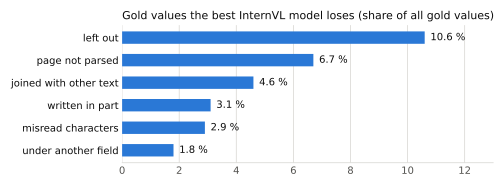

# Findings

This page summarises what changed the score and what did not, in the order the work happened. Every change was
compared with a named baseline run, usually over three training seeds, and was kept only if it beat the
seed-to-seed spread (about 0.012 F1) on both development sets: 50 reviewed gold pages and 79 validation pages.
Scores below are lenient field F1 on those two sets, written as gold / validation. The full record of every run,
including the reasoning before each one, is in the [research log](research/journal.md); the code of the methods
that were not adopted is kept in the [`archive-2026-10-15`](https://github.com/iamkucuk/tiny-resume-parser/tree/archive-2026-10-15) tag.

## How the recipe developed

**Getting a valid answer at all.** The first LoRA fine-tune of InternVL3-1B reached a low training loss, yet none
of 10 answers was valid JSON: every answer repeated one entry of the label's `corrections` list until the
2,500-token limit. That list recorded spelling fixes the labelling model had made, so its content was not visible
on the page. Removing it from the target, together with token perturbation (on about one page in ten, one input
token of the answer is replaced by a random token while the target stays correct; Nougat, arXiv 2308.13418),
raised valid answers to 21 of 50. The two changes were made in the same run, so their separate effects are unknown;
a test of token perturbation alone is running. The lesson that stayed: training loss did not show the loops; only
generating answers did.

**LoRA, then full fine-tuning.** More epochs, a trainable image-to-text projector and 12 image tiles instead of 6
brought LoRA to about 0.65 on the gold pages, where it stopped improving. The 12 tiles helped tall pages (+0.094 on
the 6 such gold pages) and nothing else. Fine-tuning all weights instead gave 0.693 / 0.669, about +0.03.

**Image noise and the vision encoder.** Training on pages with mild noise (lower resolution, rotation up to 1.5°,
contrast, blur, JPEG artefacts, on half of the pages) and also training the vision encoder raised the 3-seed mean
from 0.684 / 0.671 to 0.706 / 0.708. Each change alone helped only one of the two sets.

**Weight averaging.** Averaging the weights of 10 fine-tuned models ("model soup", arXiv 2203.05482) gave
0.728 / 0.732, +0.024 on both sets over the mean of single models, at no extra inference cost. Larger averages (13 to 19
models) did not score higher on validation, so the 10-model average is the released InternVL model.

**Answer repair.** On 3 of the 50 gold pages the best model writes no valid JSON (a loop, a bad escape, a missing
comma), and those pages hold 6.7 % of all gold values. Repairing the answer after generation (fix escapes, keep the
complete values before the break, drop repeated list items) raises gold from 0.728 to 0.746 and leaves validation
unchanged. Development decisions compare unrepaired answers; the `parse` command returns repaired ones.

**More data.** Training on half of the pages cost 0.04 to 0.08 with the same number of steps, so the number of
distinct pages matters. Adding 993 pages from a second dataset gave +0.011 / +0.013 over 6 seeds, which is within
noise; its licence is unknown, so released weights do not use it.

**The two smaller models.** The InternVL recipe did not transfer. SmolVLM-500M with it scored 0.370 / 0.460, and 10
of its 50 gold answers looped to the token limit. A 6× higher learning rate and 10 epochs gave 0.596 / 0.627; 30
image tiles instead of 12 added +0.043 / +0.032 (20 tiles scored the same over 3 seeds and was only 4 % faster on
CPU); averaging 3 seeds gave 0.644 / 0.676. granite-docling-258M needed
an even higher learning rate (1e-4: +0.024 / +0.031 over 6e-5), did worse with more than 12 tiles, and its 4-seed
average reached 0.660 / 0.649, +0.044 / +0.033 over a single model.

## What did not help

| Tried | Result |
|---|---|
| Preference training (DPO) on the model's own wrong answers | gold fell at every checkpoint, from 0.650 to 0.539 |
| Reinforcement learning (GRPO) with field F1 as the reward, 4 settings | 0.705–0.718 / 0.704–0.718, starting from 0.705 / 0.719 |
| Generating one JSON key per call (29 calls per page) | at best 0.728 / 0.710 against 0.728 / 0.732 |
| Decoding constrained to the schema | 0.694 against 0.693 and 5.4× slower; useful only to guarantee valid JSON |
| Stopping loops at generation time (repetition penalty, banning repeated word sequences) | no gain on InternVL, lower on SmolVLM; the ban also broke normal JSON |

Smaller changes that did not help either: training on labels rewritten into a canonical form (−0.01), 24 image tiles
for InternVL (−0.05 on gold), 2 pages per step (−0.02), other learning rates and epoch counts, NEFTune noise on text
embeddings, a 10× lower learning rate for the vision encoder, a first training stage on page transcripts, and a
second model that checks and fixes the labels (it fixed 14 real errors on 30 pages and introduced about 8 new ones).
Their numbers are in the [research log](research/journal.md).

## Why reinforcement learning did not help

GRPO started from the fully fine-tuned InternVL model (0.705 / 0.719). For each training page it sampled 4 answers at
temperature 1 and rewarded each with its field F1 against the label, for about 350 steps of 4 pages. Four settings
(learning rate 1e-6 and 3e-6, temperature 0.7, a KL penalty) all ended within the seed spread. The training logs, the
answers before and after, and 8 new samples per page from the starting model show why
([`grpo_probe.py`](https://github.com/iamkucuk/tiny-resume-parser/tree/archive-2026-10-15/experiments/grpo_probe.py)).

**The answers changed, but not in one direction.** After GRPO, 39 to 46 of the 50 gold answers differ from before,
about as many as after one more epoch of supervised training. On pages that stay valid JSON, the values gained and
lost cancel out (+79 and −75 at learning rate 1e-6). The net change comes from a few pages switching between valid
and invalid JSON, each holding about 100 values, which is why gold and validation moved in opposite directions.

**There was a learning signal, but little room on the training pages.** The 4 samples of a page differed by about
0.23 F1, and only 1 % of groups gave no signal. The room above the greedy answer, however, was small on the pages
GRPO trained on, because supervised training had already fitted them:

| Starting model, 8 samples per page | Greedy answer | Mean sample | Best sample | Pages where a sample beats greedy by > 0.02 |
|---|---|---|---|---|
| 40 training pages | 0.910 | 0.811 | 0.925 | 8 of 40 |
| 50 gold pages (not trained on) | 0.703 | 0.571 | 0.768 | 27 of 50 |

**Much of the reward measured whether a sample was valid JSON.** At temperature 1, 4 % of samples on training pages
are not JSON (14 % on gold pages). Leaving those out cuts the reward variance within a page to a third. Greedy
decoding rarely produces such answers, so learning to avoid them raised the training reward without changing the
greedy answer.

**The reward also follows the labels' arbitrary splits.** For 24 % of sample pairs, field F1 and content F1 rank the
two samples in opposite order: field F1 prefers the sample that splits text into fields the way the label does,
even when the other sample has more correct content.

One expected cause turned out to be wrong: the model does produce many of the values it misses. Of the values the
greedy answer misses, 74 % on training pages and 56 % on gold pages appear in at least one of the 8 samples. The
reward simply did not concentrate on them. Untested next steps follow from this: train on pages the supervised stage
has not seen, keep only pages where a sample beats the greedy answer, and reward content F1 or recall instead of
field F1.

## Where the errors are

The largest loss is values the model does not write at all. Misread characters are one of the smallest. Part of the
remaining gap is in the labels themselves. When the labelling model labels 50 reviewed pages a second time, it
scores 0.912 field F1 against them; about half of the disagreements are the same text split into fields
differently. Measured by content F1, which ignores how text is split, the second run reaches 0.967.

Model size is the strongest lever measured, but it is outside this project's limit of 1B parameters: with LoRA,
InternVL3-2B reached 0.754 / 0.716 and InternVL3-8B 0.824 / 0.812.

## Open questions

- The separate effects of removing the `corrections` list and of token perturbation (a test of the second is running).
- Why granite-docling loses accuracy above 12 tiles, and why 2 pages per step scored lower.
- Merging the pages of one CV, and faster CPU inference through quantisation.
