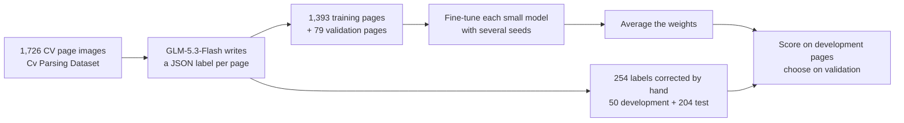
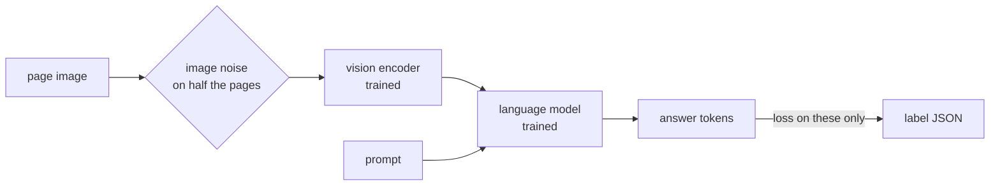

# How it works

A large model labels CV page images once. Small models learn to write the same JSON from the image alone. Several
fine-tuned copies of each small model are averaged into the released model. This page describes each step; the
effect of each choice is in [findings.md](findings.md).

## Output schema

Each page becomes one record in the [JSON Resume](https://jsonresume.org/schema) layout, with a few fields added
because the CVs contain them (`work.type`, `education.honors`, `basics.hasPhoto` and others). The sections are
`basics`, `work`, `volunteer`, `education`, `awards`, `certificates`, `publications`, `skills`, `languages`,
`interests`, `references`, `projects` and `extra`. Nothing is invented: a field that is not on the page is empty.
The schema is defined and validated with pydantic in [`schema.py`](../src/tiny_resume_parser/schema.py).

## Labels

GLM-5.3-Flash reads each page image and writes its record ([`label.py`](../src/tiny_resume_parser/label.py)). An
answer that does not fit the schema is sent back with the validation errors, and the model corrects it. The prompt
asks for text to be copied as written, except for spelling mistakes in ordinary words: those are fixed and each fix
is listed in a `corrections` field. Names, abbreviations, emails, URLs and codes are always copied letter by letter.
The small models are not trained on `corrections`, because its content is not visible on the page. Of the dataset's 2,451 pages, the 725 stored at 640 × 640 pixels were dropped: their
labels had 6.8 % wrong values, against about 1 % on larger pages.

The labels vary between runs, and this limits what the small models can learn. Run a second time on 50 pages
corrected by hand, the labelling model scores 0.912 field F1 against the corrected labels. The first run, which the
review started from, needed few corrections (0.997).

## Model input

The page image is cut into tiles, each tile becomes a set of image tokens, and the prompt is one sentence:
`Extract this CV page as JSON.`

| Model | Tiles on an A4 page | Image tokens |
|---|---|---|
| ResuVL-L | no tiles: the whole page at up to 12 × 448 × 448 px, one token per 32 × 32 px | about 1,360 at 120 dpi |
| ResuVL-L v0.1 | 12 tiles of 448 px, plus a thumbnail | about 3,300 |
| ResuVL-M | 30 tiles of 512 px (longest edge 3,072 px), plus a thumbnail | about 2,000 |
| ResuVL-S | 12 tiles of 512 px (longest edge 2,048 px), plus a thumbnail | about 830 |

The target is the record as compact JSON with empty fields left out, about 700 tokens on a typical page.

## Training

All weights are trained, including the vision encoder. The loss is computed on the answer only: image tokens, the
prompt and the chat template are masked, and a check on the first batch stops the run if any image token would be
learned. Half of the pages get mild image noise (lower resolution, rotation up to 1.5°, contrast, blur, JPEG
artefacts) that leaves every character readable, so the label stays correct. On about one page in ten, one answer
token in the input is replaced by a random token while the target keeps the correct one (token perturbation,
Nougat, arXiv 2308.13418), so the model sees what follows a wrong token. The settings for each model are in
[`configs/`](../configs); the commands are in [training.md](training.md).

## Weight averaging

Each model is trained with several seeds. For each seed, the epoch with the best validation score is kept, and
those models' weights are averaged ([`soup.py`](../src/tiny_resume_parser/soup.py); model soups, arXiv
2203.05482). The result is one model of the same size, so inference costs nothing extra.

## Reading a CV

[`parse.py`](../src/tiny_resume_parser/parse.py) renders each PDF page at 120 dpi, the resolution of the training
pages, and never reads the PDF's text layer. The model writes the answer with greedy decoding. If the answer is cut
off or has a syntax error, the complete values before the error are kept, and the result is validated against the
schema. Each page is returned as its own record; merging the pages of one CV is not implemented.
