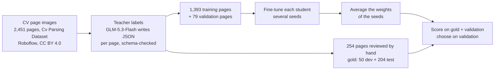
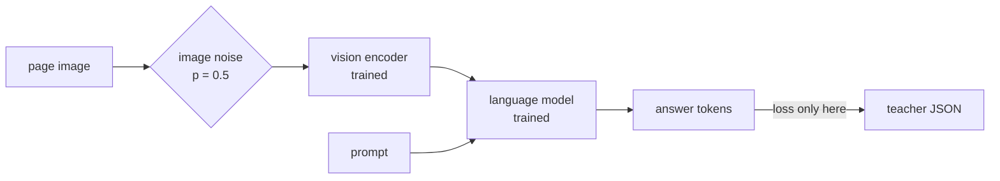

# How it works

A large teacher model labels CV page images once; small student models learn to write the same JSON from the image
alone; a few fine-tuned copies of each student are averaged into the released model.

## 1. Output schema

One record per page, following the [JSON Resume](https://jsonresume.org/schema) layout with a few additions found
in the data (`work.type`, `education.honors`, `basics.hasPhoto`, …). Sections: `basics`, `work`, `volunteer`,
`education`, `awards`, `certificates`, `publications`, `skills`, `languages`, `interests`, `references`, `projects`,
`extra`. Missing fields are `null` or `[]`; nothing is invented. Defined and validated with pydantic in
[`schema.py`](../src/tiny_resume_parser/schema.py).

## 2. Teacher labels

GLM-5.3-Flash reads each page image and writes the record ([`label.py`](../src/tiny_resume_parser/label.py)). An
answer that fails the schema is sent back with the validation errors, and the teacher corrects it. The teacher is told to copy text as written: a
spelling mistake on the page stays in the label, because the student must learn to read, not to correct.

The teacher is not perfect: on the 254 reviewed pages it agrees with the human-corrected labels at 0.912 lenient F1.
Two teacher runs on the same pages also differ (0.912 between runs), mostly in how text is split into fields. This
sets the ceiling for any student trained on its labels.

## 3. Student input

The page image is cut into tiles, each tile becomes image tokens, and the prompt is one sentence
(`Extract this CV page as JSON.`):

| Student | Tiles per A4 page | Image tokens |
|---|---|---|
| InternVL3-1B | 12 × 448 px + 1 thumbnail | ~3,300 |
| SmolVLM-500M | 30 × 512 px (longest edge 3,072 px) + 1 | ~2,000 |
| granite-docling-258M | 12 × 512 px (longest edge 2,048 px) + 1 | ~830 |

The answer is the compact JSON of the record (~700 tokens on a typical page).

## 4. Training

- **Full fine-tune** of all weights, vision encoder included (LoRA was tried first and plateaued lower).
- **Loss on the answer only.** Image tokens, prompt and the assistant header are masked; a check on the first batch
  stops the run if any image token would be learnt.
- **Image noise** on half of the pages: lower resolution, rotation up to 1.5°, contrast, blur, JPEG artefacts. Every
  character stays readable, so the label stays true.
- **Token perturbation** (Nougat, arXiv 2308.13418): a few answer tokens in the input are replaced by random tokens
  while the label keeps the correct one, so the model learns to continue correctly after an error instead of
  repeating itself.
- Settings per student are in [`configs/`](../configs); commands in [training.md](training.md).

## 5. Weight averaging

Each recipe is trained with several seeds. The saved epoch of each seed is chosen on the validation pages, and the
weights of those models are averaged ([`soup.py`](../src/tiny_resume_parser/soup.py); "model soups",
arXiv 2203.05482). The average scores higher than any single seed (InternVL: +0.024 / +0.024 over the 4-seed mean)
and costs nothing at inference: it is one model of the same size.

## 6. Reading a CV

[`parse.py`](../src/tiny_resume_parser/parse.py) renders each PDF page to an image at 120 dpi (the resolution of the
training pages), generates the answer greedily, repairs a cut-off answer (keeps its complete values), and validates
it against the schema. The PDF's text layer is never read.

Not yet implemented: merging the pages of a multi-page CV into one record (each page is returned separately).
